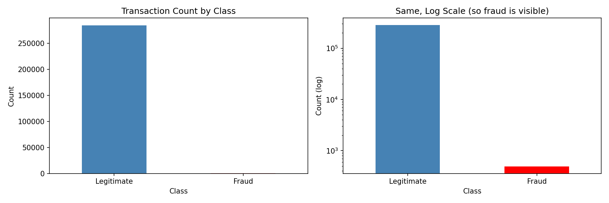
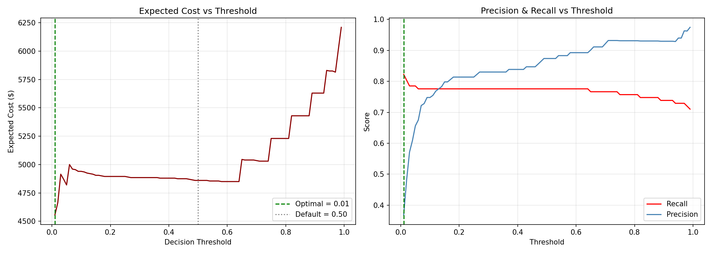
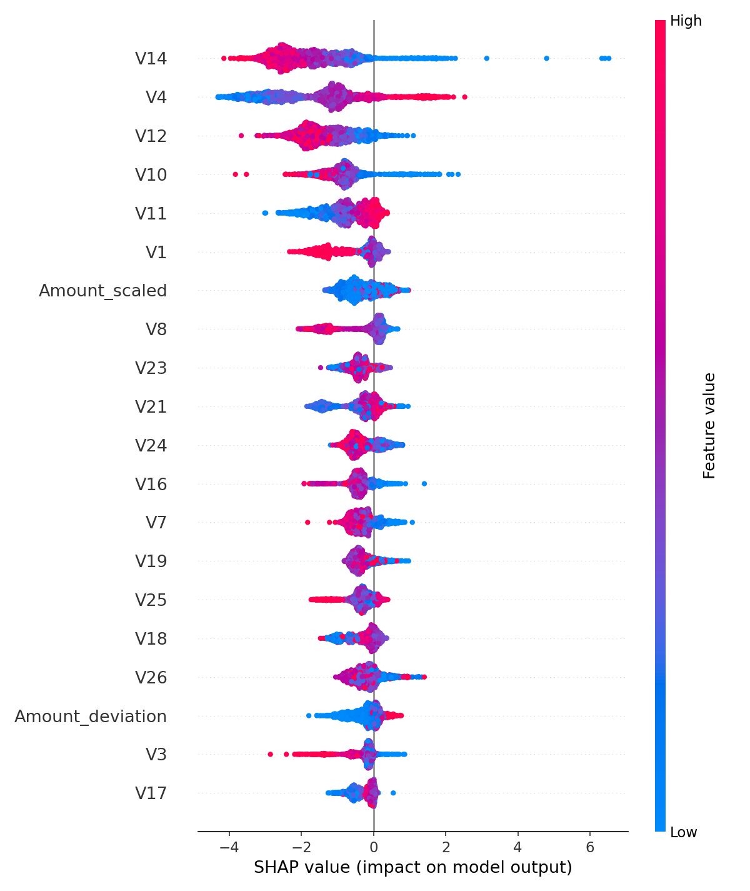
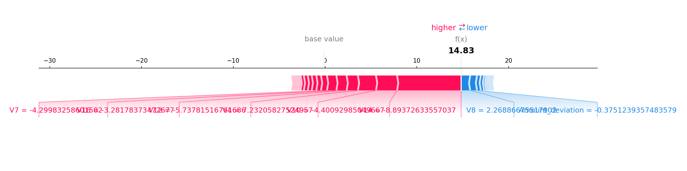

# Credit Card Fraud Detection: Cost-Aware Machine Learning

> **Headline:** XGBoost + cost-based threshold reduced expected fraud cost by **72.8%** vs a logistic baseline, while cutting false positives by **95%**  on 284,000 real transactions.

---

## Problem

A bank processes ~285k card transactions over a 2-day window. Only **0.17%** are fraudulent. Manual review capacity is limited, so the model must not only catch fraud; it must **minimize expected cost**, where:

- Missing a fraud = **$200** in direct loss
- Manually reviewing a legitimate transaction = **$5** in analyst time

This reframes fraud detection as a **cost optimization problem**, not a classification accuracy problem.

---

## Data

- **Source:** [Kaggle — ULB Credit Card Fraud Detection](https://www.kaggle.com/datasets/mlg-ulb/creditcardfraud)
- **Raw:** 284,807 transactions · 492 frauds (0.172%)
- **After deduplication:** 283,726 transactions · 473 frauds (0.167%)
- **Features:** 28 PCA-transformed features (V1–V28), `Time`, `Amount`, `Class`

> A "predict-all-legitimate" model achieves **99.83% accuracy** and catches **zero fraud**. This is why accuracy is useless here — PR-AUC, recall at low FPR, and cost-based thresholds are the correct metrics.

---

## Approach

1. **EDA**: confirmed extreme class imbalance, analyzed amount and hour-of-day patterns
2. **Cleaning**: removed 1,081 duplicate rows (19 were fraud — documented as a judgment call; could represent repeated attacks rather than data errors)
3. **Feature engineering**
   - `Is_night`: flag for transactions between 11pm–5am. **Night fraud rate was 2.7× higher** (0.38% vs 0.14%)
   - `Amount_deviation` : per-hour z-score of transaction amount
   - `Txn_count_last_hour`: velocity proxy
4. **Validation** — **time-based 70/30 split** (not random), because fraud patterns drift over time
5. **Models**: Logistic Regression (baseline) vs XGBoost
6. **Threshold tuning**: cost-based optimization ($200 per missed fraud, $5 per review)
7. **Explainability**: SHAP for global feature importance and per-alert explanation

---

## Results

| Model | Recall | False Positives | Expected Cost |
|---|---|---|---|
| Logistic Regression @ 0.5 | 89.7% | 2,915 | $16,775 |
| **XGBoost (cost-optimal)** | **82.2%** | **151** | **$4,555** |
| **Δ** | −7.5 pts | **−95%** | **−72.8%** |

The cost curve below shows why **threshold selection matters more than model choice** — the optimal operating point cuts expected cost by **73%** versus the logistic baseline.

**Realistic operating point:** At 200 alerts/day, the model catches **81% of fraud at 44% precision**: the kind of number a fraud ops team can actually staff around.

---

## Explainability

Every alert is accompanied by a SHAP explanation, so analysts can justify decisions and regulators can audit them.

**Example: single alert explanation (highest-risk fraud in the test set):**

**Top SHAP features:** V14, V4, V12, V10 (PCA features) — plus **`Amount_scaled`** and **`Amount_deviation`** (engineered), confirming the new features contribute to model decisions.

---

## Business Impact

- **72.8% reduction** in expected fraud cost vs. logistic baseline
- **95% fewer false positives** → dramatically less analyst friction and fewer blocked legitimate customers
- **Explainable alerts** via SHAP → analysts can defend decisions; regulators can audit
- **Cost-aware threshold** → tunable to any bank's actual review capacity

---

## Limitations

- Only **2 days of data**: no customer IDs, no seasonality, no long-term drift
- **Velocity is a weak proxy**: without customer IDs, rolling per-card windows aren't possible
- `scale_pos_weight` **distorts raw probabilities**: cost-based threshold corrects the decision, but probabilities aren't calibrated
- **19 duplicate frauds were dropped**: could represent repeated attacks rather than data errors; flagged as a judgment call
- Logistic regression baseline showed a **convergence warning** at 2,000 iterations — noted but acceptable for a baseline model

---

## Next Steps

- **Per-customer rolling features** (1h, 24h, 7d windows) with real customer IDs
- **Probability calibration** (Platt scaling or isotonic regression)
- **Real-time scoring API** (FastAPI + model server)
- **Drift monitoring** and retraining cadence
- **Analyst feedback loop** to capture false-positive corrections for model improvement
- **Fairness audit** across demographic segments

---

---

## Tech Stack

`Python` · `pandas` · `NumPy` · `scikit-learn` · `XGBoost` · `SHAP` · `matplotlib` · `seaborn`

---

## How to Reproduce

1. Clone this repo
2. Download `creditcard.csv` from [Kaggle](https://www.kaggle.com/datasets/mlg-ulb/creditcardfraud) and place it in `data/`
3. Install dependencies: `pip install pandas numpy scikit-learn xgboost shap matplotlib seaborn jupyter`
4. Open `notebooks/Credit_fraud_detection.ipynb` and run all cells
